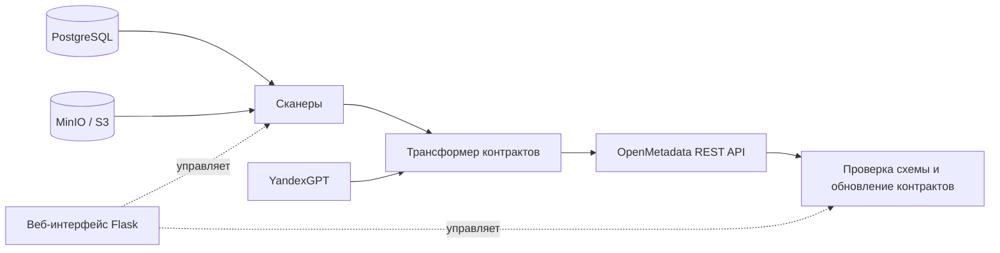

# Data Discovery Agent

Сервис, который автоматически создаёт и поддерживает в актуальном состоянии **Data Contracts** в каталоге метаданных [OpenMetadata](https://open-metadata.org/): сканирует источники данных, описывает таблицы с помощью YandexGPT и публикует контракты через REST API.

> Учебный проект, выполненный в рамках производственной практики (НИУ ВШЭ, магистратура «Инженерия данных»).

## Зачем это нужно

Описания таблиц и контракты данных (схема, владельцы, SLA) обычно ведут вручную, поэтому они быстро устаревают и расходятся с реальной структурой баз. Агент берёт эту рутину на себя: находит таблицы и файлы, описывает их, публикует контракты и замечает, когда схема источника изменилась.

## Возможности

- Сканирование **PostgreSQL**: таблицы, колонки, типы, количество строк, выборка данных.
- Сканирование **S3-совместимого хранилища (MinIO)**; схема определяется через boto3 и pandas, каждая папка рассматривается как отдельный датасет.
- Генерация описаний через **YandexGPT** по списку колонок. Если модель недоступна, запасной алгоритм строит описание по структуре таблицы, поэтому контракт создаётся в любом случае.
- Публикация **Data Contract** в OpenMetadata: нормализованные типы полей, первичные ключи, владелец, SLA. Сущность находится по FQN.
- Обнаружение расхождений схемы (**schema drift**): добавленные, удалённые и изменённые колонки; обновление контракта PATCH-запросом.
- **Веб-интерфейс на Flask**: запуск сканирования, статусы, создание и обновление контрактов.
- Тестовое окружение поднимается через **Docker Compose**.

## Как это устроено



| Модуль | Назначение |
|---|---|
| `discovery_agent/connectors/` | Подключение к PostgreSQL и S3 |
| `discovery_agent/scanner.py`, `s3_scanner.py` | Обход источников и сбор метаданных |
| `discovery_agent/ai/yandex_client.py` | Клиент YandexGPT |
| `discovery_agent/transformers/contract_transformer.py` | Формирование контракта (описание, схема, владелец, SLA) |
| `discovery_agent/clients/openmetadata_client.py` | REST-клиент OpenMetadata |
| `discovery_agent/contract_updater.py` | Сравнение схем и обновление контрактов |
| `discovery_agent/create_contracts_with_ai.py`, `create_s3_contracts.py` | Создание контрактов для PostgreSQL и S3 |
| `web_ui.py`, `templates/` | Веб-интерфейс |

## Стек

Python 3.10, Flask, psycopg2, boto3, pandas, requests, Docker / Docker Compose, PostgreSQL, MinIO, OpenMetadata, YandexGPT.


## Быстрый старт

Нужны Docker с Docker Compose и аккаунт Yandex Cloud (для YandexGPT).

**1. Склонируйте репозиторий и создайте `.env`**

```bash
git clone https://github.com/Uliana79/data-discovery-agent.git
cd data-discovery-agent
cp .env.example .env
```

**2. Запустите OpenMetadata**

Папка должна называться именно `openmetadata-docker`: от этого зависит имя сети `openmetadata-docker_app_net`, к которой подключается агент.

```bash
cd openmetadata-docker
docker-compose -f docker-compose-postgres.yml up -d
cd ..
```

**3. Получите токен OpenMetadata**

Откройте http://localhost:8585 и войдите (по умолчанию `admin@open-metadata.org` / `admin`). Затем перейдите на http://localhost:8585/users/admin → **Access Token** → **Generate New Token**. Вставьте токен в `.env` как `OPENMETADATA_TOKEN`.

**4. Получите доступ к YandexGPT**

- Сервисному аккаунту в Yandex Cloud назначьте роль `ai.languageModels.user`.
- `YANDEX_FOLDER_ID` — идентификатор каталога из консоли Yandex Cloud.
- `YANDEX_IAM_TOKEN` — результат команды `yc iam create-token`. IAM-токен живёт ограниченное время (не больше 12 часов), при ошибках авторизации выпустите новый.

Без токена YandexGPT сервис работает, но описания строятся запасным алгоритмом.

**5. Добавьте источники в OpenMetadata**

- PostgreSQL: http://localhost:8585/settings/services/databases → **Add New Service** → Postgres. Имя сервиса `postgres_source`, хост `localhost:5433`, пользователь `source_user`, пароль `source_pass`, база `source_db`.
- S3: http://localhost:8585/settings/services/storages → **Add New Service** → S3. Имя сервиса `s3_source`, Endpoint URL `http://host.docker.internal:9000`, ключи `minioadmin` / `minioadmin`, регион `us-east-1`.

Имена сервисов должны совпадать с `SOURCE_DB_SERVICE_NAME` и `S3_SERVICE_NAME` в `.env`.

**6. Запустите агента**

```bash
docker-compose up -d
```

Интерфейс агента: http://localhost:5001.

## Тестовые данные

- PostgreSQL (`init-scripts/postgres/01-init.sql`): таблицы `users`, `orders`, `products`, `payments`, `customers`.
- MinIO (`init-scripts/minio/init.sh`, `minio-data/`): бакет `data-contracts` с папками `users`, `orders`, `users2` и CSV-файлами.

## Адреса сервисов

| Сервис | Адрес |
|---|---|
| Интерфейс агента | http://localhost:5001 |
| OpenMetadata | http://localhost:8585 |
| MinIO Console | http://localhost:9001 (`minioadmin` / `minioadmin`) |
| PostgreSQL (тестовая БД) | localhost:5433 |

## Структура репозитория

```
.
├── README.md
├── .env.example
├── .gitignore
├── docker-compose.yml
├── Dockerfile.agent
├── requirements.txt
├── web_ui.py
├── discovery_agent/
│   ├── ai/
│   ├── clients/
│   ├── connectors/
│   ├── transformers/
│   ├── config.py
│   ├── scanner.py
│   ├── s3_scanner.py
│   ├── contract_updater.py
│   ├── create_contracts_with_ai.py
│   └── create_s3_contracts.py
├── templates/
├── init-scripts/
├── minio-data/
└── openmetadata-docker/
```

## Ограничения

- Прототип: нет автотестов, веб-интерфейс запускается в режиме отладки Flask и не предназначен для публичного доступа.
- Данные доступа в `docker-compose.yml` и `.env.example` (`source_pass`, `minioadmin`) относятся к тестовому окружению. Для реальных источников используйте свои секреты и не публикуйте их.
- Сканер PostgreSQL работает с одной схемой (по умолчанию `public`).

## Благодарности и лицензии

Файл `openmetadata-docker/docker-compose-postgres.yml` основан на примере развёртывания из проекта [OpenMetadata](https://github.com/open-metadata/OpenMetadata).
